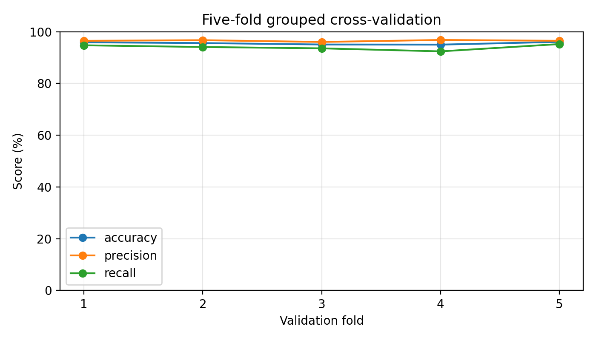
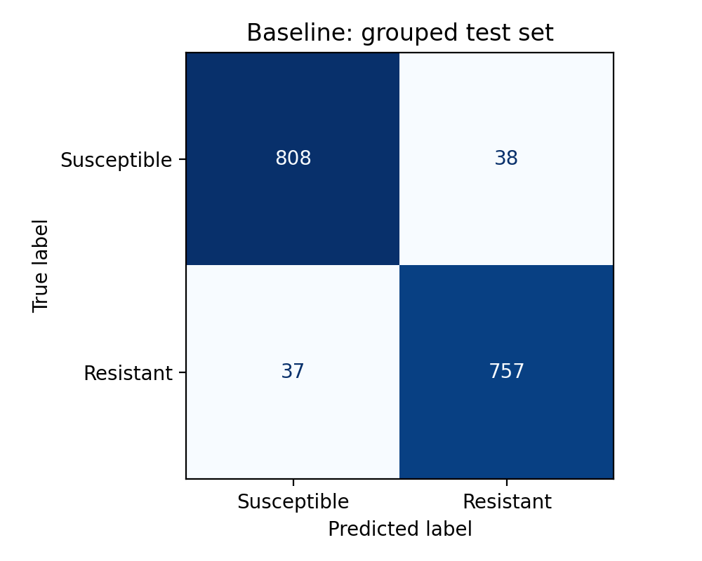

# 大肠杆菌氨苄西林耐药预测：基线实验

## 目标
使用公开的基因与突变检出条目预测实验药敏标签。

## 数据
- 标签与基因信息来自NCBI。
- 9754条原始药敏记录。
- 修复15处CSV引号异常。
- 保留明确的耐药、敏感标签。
- 排除1个标签冲突的BioSample并去重。
- 最终8146个候选样本。

## 方法
- 特征：名称与检出类别组成的二值条目。
- 模型：逻辑回归。
- 按SNP群划分；无群信息样本各自作为一组。
- 分组训练6506个，测试1640个。

## 结果
原模型：
- 准确率95.43%。
- 耐药精确率95.22%。
- 耐药召回率95.34%。
- 漏报37个，误报38个。

敏感性分析：
- 仅排除训练集89个标签与MIC可疑的样本。
- 测试集保持不变。
- 准确率95.98%。
- 漏报26个，误报40个。
- 12个预测由错变对，3个由对变错。

## 数据质量发现
训练集中89个样本标为敏感，但记录MIC >32 mg/L。
代表样本的原始BioSample页面也存在该矛盾。
尚未确定标签或MIC哪个字段错误，未自动翻转标签。

## 限制
- 测试集已用于探索，结果属于探索性评估。
- 无SNP群编号不能证明菌株彼此无关。
- 特征基于已有检出结果，未直接使用完整基因组序列。
- 未知条目在当前编码器中被忽略。
- 尚未完成独立外部验证。

## 工程验证
模型保存、加载及批量预测接口均已验证一致。
## 训练集内部五折分组交叉验证

仅使用原分组训练集的6506个样本，原测试集不参与。
按保存的group_id进行StratifiedGroupKFold划分。
各折训练与验证部分无组重叠。
每折独立拟合编码器和逻辑回归模型。
保留原始训练标签，未排除89个可疑样本。

各折指标的平均值与样本标准差：
- 准确率：95.54%，标准差0.49个百分点。
- 耐药精确率：96.52%，标准差0.30个百分点。
- 耐药召回率：94.02%，标准差1.09个百分点。

召回率在各折间的波动较大。
这些结果属于当前数据上的内部验证，不是外部验证。
## 结果图

### 训练集内部五折分组交叉验证

### 原始基线模型的分组测试结果

